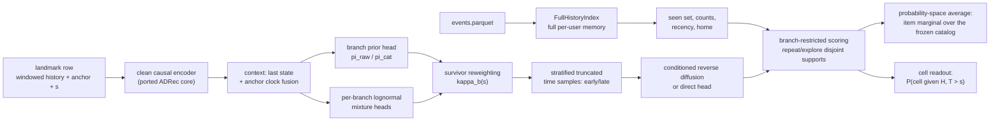

# Modeling

The ADRec-STILL model family: the joint law, the observable repeat/explore
branches, the training losses, silence-conditioned inference, the four silence
cells, and what every registered backend can and cannot claim. Everything here
describes the code in `adrec_still/models/adrec_still/`,
`adrec_still/evaluation/cells.py`, and `adrec_still/evaluation/silence_eval.py`.

## The base joint law

Per row (history `H`, total gap `T`, next item `Y`), with `b` ranging over the
two observable branches:

```
f(T, Y | H) = sum_b  pi_b(H) · f_b(T | H) · q_b(Y | H, T)
S(s | H)    = sum_b  pi_b(H) · S_b(s | H)
kappa_b(s)  = pi_b(H) · S_b(s | H) / S(s | H)        (survivor posterior)
```

- `pi_b(H)` is the branch prior, computed from `H` only — never from the
  elapsed silence `s`.
- `f_b(T | H)` is the branch's total-gap time density (a lognormal mixture).
- `q_b(Y | H, T)` is the branch-restricted item distribution produced by the
  conditioned diffusion (or direct) head.

### `pi_raw` vs the catalog projection `pi_cat`

`pi_raw` is the event-type prior over branches and never sees catalog support:
it describes the next *event* whatever its item is. The catalog projection
`pi_cat` renormalizes `pi_raw` after masking a branch only when its
known-item support is empty (a user who has never visited a known item has no
repeat branch *in the catalog view*; a user who has seen the whole catalog has
no explore branch). Empty-support masking affects only the catalog view — the
all-event time mixture and `pi_raw` never read it. The ranking/joint math over
the frozen catalog uses `pi_cat`; the all-event time NLL uses `pi_raw`.

### Repeat/explore are observable branches

The branch of a gap is an **observable label**, judged on raw item IDs over the
complete per-user past (the `FullHistoryIndex` built from `events.parquet`):

- a return to a POI last visited *before* the encoder's truncated history
  window still counts as a repeat;
- two distinct out-of-vocabulary raw IDs never match through their shared UNK
  encoding;
- a censored gap has no target and therefore no branch label.

`q_repeat` is supported on the known items the user has seen anywhere in
their full past; `q_explore` on the unseen known items. The supports are
**disjoint** (a candidate is masked to `-1e9` in exactly one branch), and
together they cover the known catalog. That disjointness is what lets
`kappa_repeat(s)` — the catalog-view survivor posterior of the repeat branch —
read directly as "the probability that the next known-catalog event is a
repeat, given the user has been silent for `s`".

### Per-branch time mixtures

Each branch owns a lognormal mixture over the total gap `T` in native seconds
(`mixture_components`, default K=2). Three different things must not be
conflated:

- **statistical components** (K per branch) — flexibility of one branch's
  time density;
- **branches** (2) — observable repeat/explore event types;
- **silence cells** (4) — a spatial×temporal readout of the joint forecast
  (below), not a latent structure of the model.

All mixture math runs in float64; component log-survival uses
`torch.special.log_ndtr` (see [MIGRATION.md](MIGRATION.md)).

## Training

### The gap-censor profile

`adrec_still` and `still_direct` train under
`adrec-still-gap-censor-v1`: the survival training view filtered to its
`s = 0` rows, so every actual gap contributes exactly one observed row and
every terminal exposure one censor row. Weights are per-row unit weights
(`adrec-still-gap-unit-weighting-v1`); the landmark-grid reweighting used by
other profiles does not apply.

### Losses

Per row, the time-and-type NLL in the raw (all-event) view:

- **observed, branch-labeled**: `-log pi_b(H) - log f_b(T | H)` for the
  labeled branch `b`;
- **observed, unlabeled** (no resolvable raw-ID label): the marginal
  `-log sum_b pi_b f_b(T)`;
- **censored** (exposure `C`, no target): `-log sum_b pi_b S_b(C)`.

On observed rows whose target is a known catalog item, two item terms are
added:

- the **branch-restricted CE surrogate** (weight `ce_weight`, default 1.0):
  repeat rows score the full seen set (with a learnable full-history memory
  bonus `w_f·log1p(count) − w_r·log1p(hours since last visit)`), explore rows
  score the target against sampled negatives with seen items masked out;
- the **ADRec denoising MSE** (weight `loss_scale`, default 1.0), the
  diffusion x0-prediction objective, with the item denoiser teacher-forced on
  the observed `T` (and the branch label) through the core's full-scale
  context hook.

Each component is logged separately in `metrics.jsonl`
(`time_type_nll`, `item_ce`, `diffusion_mse`, plus row counts). **CE + MSE is
a diffusion training surrogate, not an exact reverse-mixture marginal NLL, and
is never reported as one.**

The ablation variants train under different profiles: `adrec_repeat` is
event-only (one observed-known `s = 0` row per gap, no time model, no
censors; its type term is the branch-prior NLL), and the elapsed ablations
train on the full landmark grid of observed-known rows.

## Inference

A forecast is built once per batch from `H` and the elapsed silence `s` only
(`SilenceForecast` in `forecast.py`):

1. **Branch weights** — `pi_raw` from `H`; `pi_cat` masks empty-support
   branches; with a time model the survivor posterior
   `kappa_b(s) = pi_cat_b · S_b(s) / S_cat(s)` reweights them.
2. **Stratified truncated time samples** — with `a` the cell time threshold,
   per-branch strata `[s, a)` (early, when `s < a`) and `[max(s, a), ∞)`
   (late) carry analytic masses computed as stable log-space differences.
   Each truncated draw first reweights the mixture components by
   *prior × in-stratum mass*, then inverts the chosen component's survival
   between the stratum endpoints — no rejection loops, no hard caps.
3. **Item generation** — one reverse-diffusion (or direct-head) pass per
   (branch, stratum, time sample, latent); `--time-samples` (default 2) and
   `--diffusion-samples` (default 1) multiply out, and the same noise and
   samples serve every catalog chunk and the cell readout. The noise
   generator is seeded from the fixed evaluation seed
   (`eval_noise_seed`, default 20251014; `--eval-seed`) combined with a
   content hash of the batch's history, so an unchanged history reproduces
   its forecast. `--inference-steps` shortens the reverse schedule by
   re-spacing, never by clipping.
4. **Scoring** — per-sample branch-restricted scores are normalized over the
   frozen catalog once (chunked, float64), and item probabilities are
   averaged **in probability space** across samples with the stratum weights
   (never logits).

The Monte-Carlo configuration (`estimator`, `time_samples`,
`diffusion_samples`, `inference_steps`, `mc_sample_count`) is recorded in the
forecast extras and surfaces as `mc` metadata in evaluation results; the
known-item mark NLL of these models is reported as `poi_nll_mc` to mark it as
a Monte-Carlo estimate.

## The five variants

One class (`AdrecStillModel`) carries all registered variants — the same
modules, differing only in flags:

| name | branches | time model | elapsed cond. | item head | what it is for |
| --- | --- | --- | --- | --- | --- |
| `adrec_repeat` | yes | none | no | diffusion | repeat-memory ablation: does the full-history repeat structure alone help? (event-only training) |
| `adrec_elapsed` | no | none | yes | diffusion | elapsed-conditioning ablation: does feeding `s` directly help, without branch structure? |
| `adrec_repeat_elapsed` | yes | none | yes | diffusion | both of the above, still without a time model |
| `adrec_still` | yes | lognormal | no | diffusion | the full model: branches + survival-reweighted time mixtures + silence cells |
| `still_direct` | yes | lognormal | no | direct | diffusion ablation: identical probabilistic structure with a deterministic item head |

## The four silence cells

Two axes, kept exactly as proposed:

- **local / displaced** — whether the *next* POI lies within `cell_radius_km`
  (default 10 km) of the user's activity center ("home");
- **early / late** — whether the *total* gap `T` exceeds
  `cell_time_threshold_hours` (default 24 h). Always the total `T`, never the
  residual.

Cell names: `local_early`, `displaced_early`, `local_late`, `displaced_late`.
**Repeat/explore is a different axis** and is cross-tabulated against the
cells, never substituted for them.

- `cell_radius_km = 10` and `cell_time_threshold_hours = 24` are engineering
  starting points awaiting research calibration. They are configuration, not
  confirmed settings, and must never be tuned on test labels.
- **Home** is the most-visited geocoded known POI (ties: smaller POI ID) of
  the causal prefix in training; evaluation freezes the prefix at the train
  cutoff, falling back to the causal prefix when a user has no usable
  pre-cutoff home.
- These are **observable outcome labels**: nothing claims to identify *why* a
  user was silent. Rows without geo support, home, an observed known target,
  or target coordinates get no label — they are counted in a reason table
  (`censored`, `oov_target`, `no_home`, `target_not_geocoded`, ...), never
  filled.
- A query already past the threshold (`s >= a`) has its early cells pinned at
  zero by construction; that `late_determined` population's (easy) accuracy
  is reported separately and never mixed into the `nontrivial` headline.

### The cell probability readout

`P(C = c | H, T > s)` is aggregated from the **same** forecast samples used
for ranking: the early/late mass is analytic (the stratum weights), and
within each stratum the spatial split sums the normalized item probabilities
over the local/displaced groups induced by the row's home and `d0`. Known
items without coordinates contribute to a reported `unresolved_mass`; the
four-cell table over geocoded support is normalized **once across all
strata**, never per stratum. Rows without a home or without a time model
report `available = False`. Cell metrics (NLL, Brier, accuracy, macro-F1,
confusion) are count-weighted, and simple comparisons (train-frequency cell
prior, elapsed-only and history+elapsed logistic classifiers) are fitted on
train-split rows with causal homes.

## Coverage and Monte-Carlo limitations

- The **all-event time NLL** is computed from the `pi_raw` view (both
  branches' mixture components merged and survival-conditioned at `s`): it
  covers every observed/censored row regardless of the target's catalog
  status. The **item metrics** cover the known catalog only. The two views
  are reported side by side and are **never summed into a single
  "full-world" joint NLL** — the item side has no density over
  out-of-catalog targets, so such a sum would be fake.
- Item probabilities of the diffusion variants are Monte-Carlo estimates;
  their variance shrinks with `--time-samples`/`--diffusion-samples` and
  their configuration always rides along as `mc` metadata (`poi_nll_mc`).
- Geo coverage is partial: non-geocoded known items are reported as
  unresolved spatial mass rather than assigned to a cell.

## Differences from the original proposal

v1 deliberately simplifies the proposal document:

- repeat/explore are **observable branches** judged on raw IDs, not latent
  modes;
- the four cells are a **readout of the joint forecast**, not a latent
  structure or a training target;
- there is **no LLH component, no four semantic latent modes, and no
  cell-conditioned diffusion** in v1 — these remain future work.

## Architecture



### End-to-end training and evaluation flow

One `python -m adrec_still train` run, in execution order. Green nodes are the
paths this fork adds; orange nodes are the explicit-refusal / interruption
safeguards.

```mermaid
flowchart TD

START(["python -m adrec_still train --data … --model … --output …"])
START --> SPEC["parse CLI into a RunSpec<br/>RunLock the output directory · fix the seed"]
SPEC --> DTYPE{"what is --data?"}

DTYPE -->|"dataset.pkl"| PKLQ{"upstream-family model?"}
PKLQ -->|"no"| PKLERR[/"explicit error: pkl carries no timestamps,<br/>so time/silence/cells are unavailable"/]
PKLQ -->|"yes"| PKLLOAD["load per-user sequences<br/>(item IDs shifted +1; PAD/UNK reserved)"]

DTYPE -->|"raw check-in file"| PRE["preprocess (reused on a cache hit)<br/>clean (Latin-1 / UTC policy)<br/>→ global chronological 70/10/20 split<br/>→ frozen vocab + POI catalog<br/>→ events / split_manifest / landmarks"]
DTYPE -->|"canonical directory<br/>(incl. old-STILL output)"| CANON["load the canonical artifacts<br/>(non-empty, train split present)"]

PRE --> CFG
CANON --> CFG
PKLLOAD --> CFG
CFG["resolve model config + training block<br/>no validation split → labeled train-loss selection"]

CFG --> FAM{"family dispatch"}

FAM -->|"floor (x8)"| FIT["fit statistics<br/>(_s: destination survival;<br/>step mode answers any s)"]
FAM -->|"baseline / still / external"| VIEW1["prepare the training view:<br/>canonical landmarks / event-only / survival"]
FAM -->|"upstream (x4)"| SEQ2["build per-user pre-cutoff sequences<br/>(strict train cutoff; no future reads)"]
FAM -->|"adrec_still (x5)"| VIEW2["survival view → its s=0 gap-censor rows<br/>build the FullHistoryIndex<br/>(raw-ID repeat labels / seen sets / homes)"]

VIEW1 --> LOOP["shared epoch loop<br/>training_step → count-weighted loss<br/>validate each epoch (exact ranking)<br/>best on improvement · atomic last each epoch"]
VIEW2 --> LOOP2["same shared loop + per-row survival losses:<br/>observed labeled −log pi_b − log f_b(T)<br/>observed unlabeled: branch-marginal<br/>censored: −log Σ_b pi_b S_b(C) (target-free)<br/>+ branch-restricted CE + diffusion MSE (logged apart)"]
SEQ2 --> STAGED["staged trainer:<br/>1 pretrain (position-free SASRec, embedding handover)<br/>2 warmup (embedding frozen)<br/>3 finetune (unfrozen, early stopping)<br/>stage switch → selection scope reset"]

FIT --> BEST
LOOP --> INT{"Ctrl+C?"}
LOOP2 --> INT
STAGED --> INT
INT -->|"yes"| KEEP[/"keep the last complete last.pt,<br/>report interrupted (resume with --resume)"/]
INT -->|"no"| BEST["reload the selection scope's best weights<br/>(eval mode)"]

BEST --> TEST["final test evaluation:<br/>exact chunked full-catalog ranking<br/>(float64 · deterministic ties · per-horizon buckets)"]
TEST --> ISNEW{"family = adrec_still?"}

ISNEW -->|"yes"| FORE["SilenceForecast:<br/>1 pi_cat support projection → kappa_b(s)<br/>2 early/late x branch strata (analytic mass)<br/>3 truncated T samples (prior x survivor first)<br/>4 reverse diffusion (noise reused across chunks)<br/>5 repeat/explore decoders → probability average<br/>6 cell readout (one normalization + unresolved mass)"]
FORE --> SILM["silence metrics:<br/>repeat/explore ranking splits · repeat rates + calibration<br/>observed/censored time NLL · poi_nll_mc / joint_nll_mc<br/>cell NLL/Brier/F1/confusion + prior/elapsed baselines"]
SILM --> OUT2
ISNEW -->|"no"| OUT2

OUT2(["results/&lt;run&gt;/: last.pt · best.pt · config.json<br/>metrics.jsonl · summary.json<br/>(re-evaluate later with `evaluate`; tabulate with `collect`)"])

classDef new fill:#1a7f37,stroke:#116329,color:#ffffff
classDef guard fill:#b35900,stroke:#7a3d00,color:#ffffff
class VIEW2,LOOP2,STAGED,FORE,SILM new
class PKLERR,KEEP guard
```



## Backend capability table

All 27 registered backends (`python -m adrec_still models`). "Time" means the
model exposes an exact residual-time distribution (censor-aware NLL is
reportable); "repeat" means it forecasts a repeat probability through the
observable branch structure; "cells" means it produces the four-cell readout.
Ranking metrics and repeat/explore *label splits* are available for every
backend (the labels come from the data, not the model).

| backend | family | kind | ranking | silence-aware input | time dist. | repeat forecast | four cells |
| --- | --- | --- | --- | --- | --- | --- | --- |
| `global_pop` | baseline | floor | yes | no | no | no | no |
| `user_history_pop` | baseline | floor | yes | no | no | no | no |
| `repeat_last` | baseline | floor | yes | no | no | no | no |
| `first_order_markov` | baseline | floor | yes | no | no | no | no |
| `global_pop_s` | baseline | floor | yes | s (reweighting) | no | no | no |
| `user_history_pop_s` | baseline | floor | yes | s (reweighting) | no | no | no |
| `repeat_last_s` | baseline | floor | yes | s (reweighting) | no | no | no |
| `first_order_markov_s` | baseline | floor | yes | s (reweighting) | no | no | no |
| `gru4rec_h` | baseline | neural | yes | no | no | no | no |
| `sasrec_h` | baseline | neural | yes | no | no | no | no |
| `sasrec_h_pm` | baseline | neural | yes | no (matched null control) | no | no | no |
| `sasrec_clock` | baseline | neural | yes | query clock | no | no | no |
| `sasrec_s` | baseline | neural | yes | elapsed s + clock | no | no | no |
| `sasrec_event_only` | baseline | neural | yes | no (event-only training) | no | no | no |
| `sasrec_elapsed` | baseline | neural | yes | elapsed s | no | no | no |
| `still_independent` | still | neural | yes | s (features) | yes (independent LN mixture) | no | no |
| `still_joint` | still | neural | yes | s (survivor reweighting) | yes (coherent joint) | no | no |
| `external_joint_lnm` | external | neural | yes | s (survivor reweighting) | yes (dependent time–mark LNM) | no | no |
| `adrec` | upstream | neural | yes | no (event-only) | no | no | no |
| `diffurec` | upstream | neural | yes | no (event-only) | no | no | no |
| `dreamrec` | upstream | neural | yes | no (event-only) | no | no | no |
| `sasrec_upstream` | upstream | neural | yes | no (event-only) | no | no | no |
| `adrec_repeat` | adrec_still | neural | yes | no (event-only training) | no | yes (`pi` only) | no |
| `adrec_elapsed` | adrec_still | neural | yes | elapsed s (conditioning) | no | no | no |
| `adrec_repeat_elapsed` | adrec_still | neural | yes | elapsed s (conditioning) | no | yes (`pi` only) | no |
| `adrec_still` | adrec_still | neural | yes | s (survivor reweighting) | yes (per-branch LN mixtures) | yes (`kappa(s)`) | yes |
| `still_direct` | adrec_still | neural | yes | s (survivor reweighting) | yes (per-branch LN mixtures) | yes (`kappa(s)`) | yes |

**On the floors and the `_s` variants**: the `_s` floors multiply the base
floor's destination probabilities by an empirical completed-gap destination
survival `S_j(s)` (shrunk by `silence_alpha`). That is a destination-only
reweighting estimated from **completed** training gaps — it is *not* a
censor-aware survival model and exposes no time distribution. Its results
must never be presented as four-cell modeling or as censor-corrected time
quality; it exists to show how much of the silence signal a trivial
adjustment already captures.
